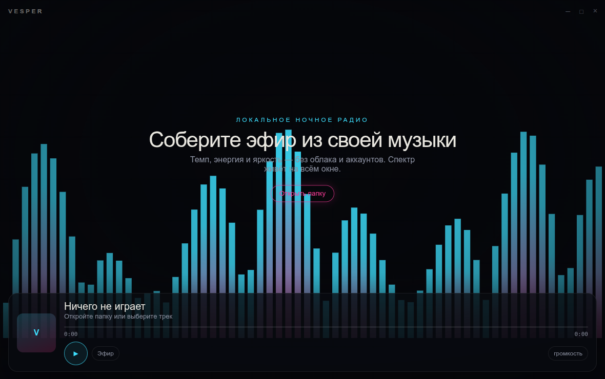
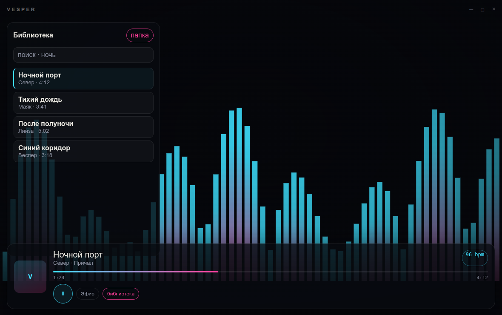
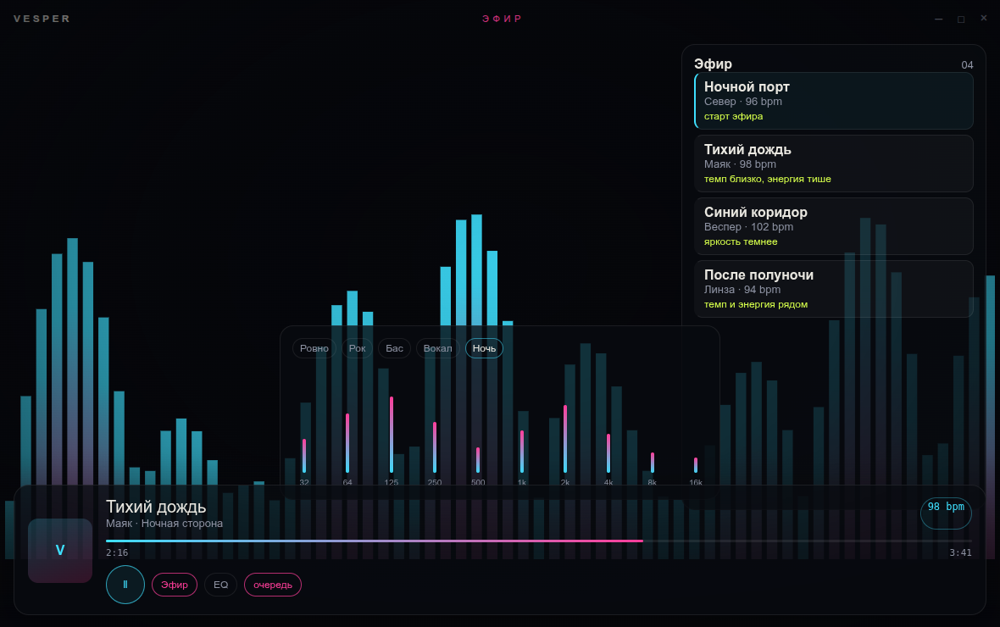

# Vesper

Ночной плеер для своей музыки. Тёмный экран, спектр на всё окно и эфир, который собирается на компьютере из файлов в папке. Облака и аккаунта нет.



## Возможности

Библиотека одной папки: теги, обложки, поиск и очередь. Клик по треку ставит его и то, что ниже в списке.



Эфир — это не радио из интернета. Плеер смотрит темп, энергию и яркость звука и выстраивает около 30 своих треков так, чтобы следующий был рядом с предыдущим. У каждой записи короткая причина: темп, энергия или яркость. Это не сведение бит в бит.

Эквалайзер на 10 полос, пресеты «Ровно», «Рок», «Бас», «Вокал» и «Ночь». Повтор выключен, всей очереди или одного трека. Перемешивание. Громкость и перемотка.



Форматы: mp3, flac, ogg, wav, aiff, aac, alac и m4a читает сам плеер. Opus, wma, ape, wavpack и остальные, которые понимает ffmpeg, идут через него, если ffmpeg установлен.

## Стек

| Слой | Чем сделано |
| --- | --- |
| Окно | Tauri 2, системный WebKitGTK 4.1 |
| Интерфейс | React 19, Vite, TypeScript |
| Шрифты | Instrument Sans, IBM Plex Mono |
| Звук | cpal, вывод в стерео на частоте устройства |
| Декодер | Symphonia, запасной путь через ffmpeg |
| Теги и обложки | lofty |
| Память библиотеки | SQLite |
| Спектр и темп | rustfft: 64 полосы, оценка BPM по первым секундам файла |
| Платформа | Linux, пакет `.deb` для amd64 |

Windows в этот выпуск не входит.

## Установка

Пакет Linux amd64: `Vesper_0.1.0_amd64.deb`, около 6 МБ. Ему нужны GTK 3 и WebKitGTK 4.1. На Ubuntu 24.04 это пакет `libwebkit2gtk-4.1-0`. Для opus, wma, ape и других редких форматов нужен ещё `ffmpeg`.

```bash
sudo apt install ./Vesper_0.1.0_amd64.deb
```

После установки программа запускается командой `vesper`.

На машине, где собирался этот выпуск, файл лежит в `release/Vesper_0.1.0_amd64.deb`. Эта папка не входит в git: установщик не хранится рядом с исходниками. Во вкладку Releases его можно приложить вручную к тегу `v0.1.0`.

## Сборка из исходников

Нужны Node.js 20, Rust, ffmpeg, `pkg-config`, `libwebkit2gtk-4.1-dev`, `libgtk-3-dev`, `libasound2-dev`.

```bash
npm install
npm run tauri dev
```

Пакет установщика:

```bash
npm run tauri build
```

Готовый файл появляется в `src-tauri/target/release/bundle/deb/`.

`dev.sh` запускает плеер на машине, где системного WebKit 4.1 нет и библиотеки лежат в `~/.cache/vesper-sysroot`.

## Лицензия

MIT. Текст в файле [LICENSE](LICENSE).
